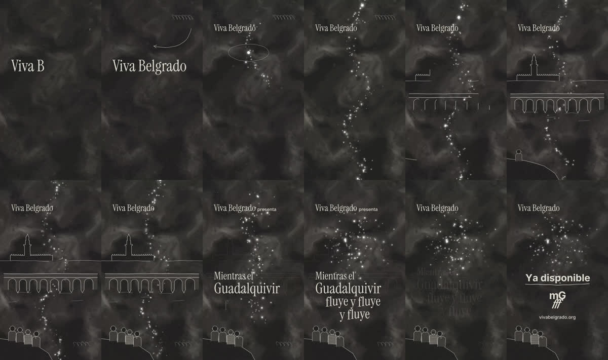

# Fluye: vídeo animado para *Mientras el Guadalquivir fluye y fluye y fluye*

Pieza vertical (9:16, 30 s) en estilo **dibujo animado a lápiz** con la identidad visual del quinto disco de Viva Belgrado. El arte original del disco es de Josu Larrea.



**Idea:** en la portada, el río es una constelación de puntos de luz. Una gota cae, se abre en un río de luz que pasa bajo el Puente Romano de Córdoba, cuatro figuras lo miran desde la orilla y los puntos suben al cielo mientras aparece el título.

| Escena | Tiempo | |
|---|---|---|
| Papel | 0–4 s | Garabato a lápiz y «Viva Belgrado» revelado como tinta |
| La gota | 4–11 s | Gota con squash & stretch → río de puntos de luz |
| Córdoba | 11–19 s | Mezquita y Puente Romano dibujándose; la banda aparece en la orilla |
| Fluye | 19–26 s | El río sube al cielo; título en tres golpes con «fluye» ondulando |
| Cierre | 26–30 s | «Ya disponible», monograma mG fff, web |

## Uso

```bash
npm install
npm test          # lógica pura + integración en Chromium (determinismo, fuentes, tamaño)
npm run preview   # http://localhost:5173 · espacio = play/pausa · ?t=12 salta a 12 s
npm run frames    # fotogramas clave en out/frames + out/contactos.png
npm run render    # out/fluye-9x16.mp4 (H.264, 1080×1920, 30 fps, ~45 MB)
```

Requiere Node 22, ffmpeg y Playwright con Chromium. El vídeo no lleva audio: la canción se añade en edición.

## Cómo está hecho

- **Spec-Driven Development:** [`specs/spec.md`](specs/spec.md) (qué y por qué), [`specs/plan.md`](specs/plan.md) (cómo) y [`specs/tasks.md`](specs/tasks.md) (orden TDD).
- **Canvas 2D determinista:** cada fotograma es una función pura de `t` y todo el azar sale de semillas, así que la preview y el export coinciden píxel a píxel.
- **Lenguaje cartoon:** *line boil* a 12 fps (animar a doses), squash & stretch, rebotes con *overshoot* y movimiento secundario (cabeceo a ~120 bpm, una cabeza que se apoya en el hombro de al lado, otra que mira al cielo).
- **Identidad:** cinco tokens monocromos (`src/config.js`), nube analógica fBm, grano de película, motas bokeh, Instrument Serif más Inter Bold.

---

## Reel de reseña · Colores Ruidosos (`reel.html`)

Reel 9:16 de 80 s, sin narración, con las 34 tarjetas del guion (T1–T34) en 7 escenas. Las escenas 1–4 usan la estética del disco (la 4 es «Lo que la banda dice» + cartel de gira); a los 42 s un barrido circular cambia al tema de Colores Ruidosos para la opinión, el 9/10 y el cierre.

```bash
npm run preview:reel   # http://localhost:5173/reel.html
npm run frames:reel    # hoja de contactos
npm run render:reel    # out/reel-9x16.mp4
npm run render:reel -- --audio "super-futuro.mp3" --audio-start 42   # con la canción, fundido de entrada y salida
```

| Qué cambiar | Dónde |
|---|---|
| Textos, duración de cada tarjeta (en pulsos), palabras resaltadas | `src/reel/script.js` |
| Tempo de la canción y punto del primer pulso | `BPM` y `OFFSET` en `src/reel/script.js` |
| Colores de la marca | `src/reel/theme.js` (**provisional**) |
| Logo, portada en alta resolución | `assets/logo-cr.png`, `assets/portada.jpg` (si no están, se usan versiones procedurales) |
| Foto de la banda | `assets/banda.jpg` (recortada del cartel) |

Si alguna tarjeta se marca `pending: true`, sale con el sello **PENDIENTE** y el render avisa por consola. Verificación de datos en [`specs/reel/spec.md`](specs/reel/spec.md) §6.

Las imágenes de `assets/referencias/` son carteles del disco usados solo como guía de estilo. Esta es una pieza no oficial.
